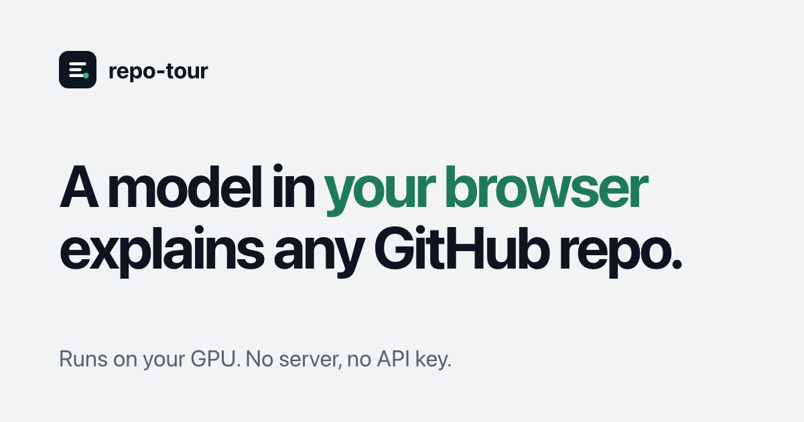

# repo-tour

A codebase walkthrough written by a small language model running in your browser. Paste a public GitHub repo: the model downloads once, runs on your GPU through WebGPU, reads the repo file by file, and explains it. There's no server and no API key.



## How it works

Everything runs in one browser tab. The model is [WebLLM](https://github.com/mlc-ai/web-llm) in a Web Worker, and the repo comes straight from GitHub's public API. Every model on offer has a 4,096-token context window, so the agent never sees the whole repo. It works the way a person skims a codebase:

1. **Read the README.** The file list is ranked: README and the package manifest first, then entry points like `src/index.ts`. Tests, lockfiles, vendored code, build output and binaries are left out.
2. **Choose the next file.** The model sees its notes so far and the 40 most promising unread files, and answers in JSON. That answer is decoded against a schema whose only allowed paths are those 40, so it can't ask for a file that doesn't exist. `DONE` joins the allowed answers only after two files are read.
3. **Take notes.** Each file is cut to about 1,700 tokens, keeping the top (imports, exports, first definitions), and turned into a one-line role plus up to four facts. Older notes shrink to one line so they all fit.
4. **Write the walkthrough** from the notes, then check it. Every file path it mentions is looked up in the repo's real file list. Paths it read are underlined, real but unread paths are plain, and paths that don't exist are struck through.

```
GitHub API ──> rank files ──> README ──> [pick next file ──> fetch ──> notes] x up to 5 ──> walkthrough ──> path check
                                          JSON schema:                  ~1,700 tokens
                                          real paths only               of each file
```

## Run it

Requires Node 22+ and, to run a model, a browser with WebGPU (recent Chrome or Edge, or Safari 26, on a desktop or laptop).

```bash
git clone https://github.com/thegreatola/repo-tour
cd repo-tour
npm install
npm run dev        # http://localhost:5173
npm run build      # a static site in dist/, for any static host
```

| Model | GPU memory |
|---|---|
| Qwen2.5 1.5B (default) | about 1.6 GB |
| Qwen2.5 3B | about 2.4 GB |
| Llama 3.2 1B | about 0.9 GB |

On GPUs without 16-bit float support, the 32-bit builds of the same models are used. The weights download from Hugging Face the first time and stay in the browser's cache.

Browsers without WebGPU can watch recorded runs instead: a recording is the event stream of a real run, played back at its real speed. A run made in development can be saved with "Save this run as a recording" and added to `public/replays/`. The trade-offs table on the page is computed from those recordings, so every number on it is measured.

## Design decisions

**The model fills in a form; the browser does the work.** Small models don't call tools reliably, so the model never writes a tool call. It picks from a constrained list, and the page fetches the file. A malformed answer falls back to the top-ranked unread file and says so, instead of failing the run.

**Every prompt is planned for 4,096 tokens.** There's no tokenizer until the model loads, so prompts are sized with a conservative estimate (3 characters a token), and the real counts the engine reports are shown per call. If a prompt still overflows, the file excerpt is halved and the call retried. A test builds a 300-file repo with large files and checks that every prompt plus its answer fits.

**Model output is never trusted as HTML.** The walkthrough's Markdown is escaped before it's formatted, and everything else the model writes goes into the page as text.

**The first load is small.** WebLLM is several megabytes, so it loads after the page is up, and only on machines with WebGPU. The page itself is about 10 KB gzipped.

**Nothing is sent anywhere but GitHub and the model host.** No cookies, no analytics, no server. GitHub's API allows 60 requests an hour per visitor, and a run uses two; file contents come from `raw.githubusercontent.com`, which doesn't count against that.

## What had to be cut

- **Whole files:** about 1,700 tokens of each, from the top.
- **Breadth:** five files a run at most. It's a first look at a repo, not a review.
- **Private repos:** reading them would need a token, and a static page shouldn't handle secrets.

## Tests

```bash
npm test
```

16 tests, all offline, with a fake GitHub and a scripted model:
- **The agent loop:** README first, `DONE` only after two files, no re-reads, the fallback on a malformed answer, the retry on context overflow, and the 4,096-token budget on a large repo.
- **Ranking and filtering**, **clipping**, **path checking** (read, real, made up), **Markdown escaping**, **GitHub errors** (missing repo, rate limit), **replay**.
- **Model config:** the GPU memory figures and the 4,096-token window match the installed WebLLM.

CI runs typecheck, tests and the build on Node 22 and 24.

## Status

The agent, the page and the tests are done. Recorded runs and measured speeds for each model come next, then hosting.

## License

MIT
